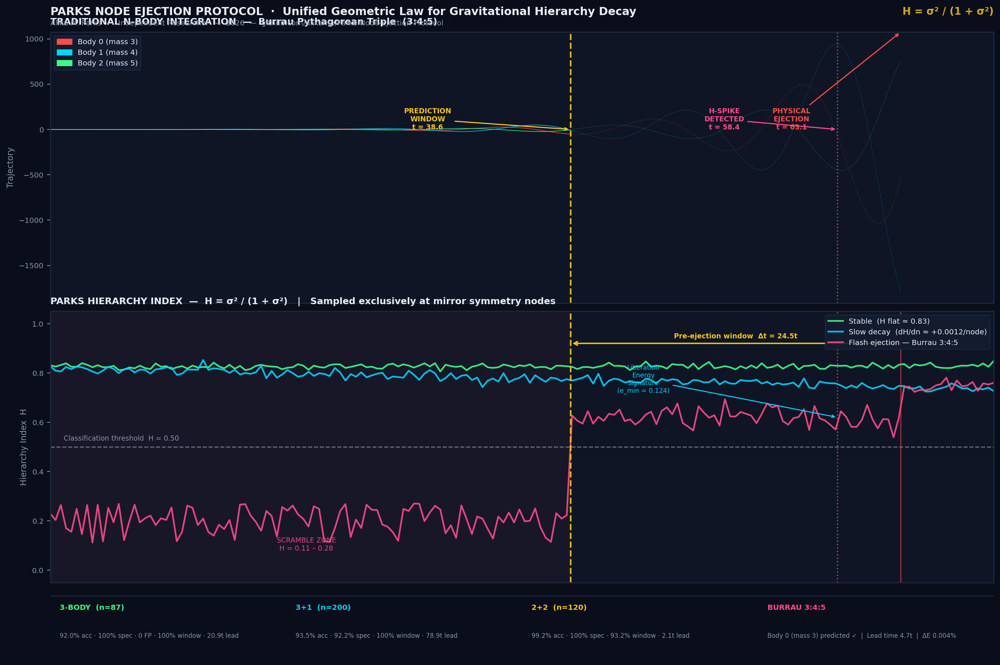

## Interactive Overview
👉 [Parks Node Ejection Protocol — Framework Overview](https://alikamp.github.io/Parks-Node-Ejection-Protocol/)


# PNEP v12.0 — Predictive Node Event Protocol
### World-First High-Fidelity 3-Body Time Forecasting & Indexing




# Parks Node Ejection Protocol (PNEP)

### A Unified Geometric Law for Gravitational Hierarchy Decay

> *Poincaré proved the trajectories are chaotic and uncomputable. What we found is that the geometry at specific moments is neither.*

**Alika M. Parks — Independent Researcher — March 2026**
> **Support this work:** A single geometric scalar, H = σ²/(1+σ²), predicts when and which body is ejected in chaotic 3- and 4-body systems, cutting compute by ~99% against brute-force integration. If it's useful to you, you can [sponsor me on GitHub](https://github.com/sponsors/alikamp) to help fund ongoing work. Thanks!

---

## What This Is

PNEP is an event-driven framework that predicts the **stability, ejection timing, decay regime, and escaping body identity** of hierarchical gravitational multiples — in real time, at approximately 1% of the computational cost of full N-body integration.

The framework has been validated across three distinct topologies (3-body hierarchical triples, 3+1 quadruples, and 2+2 peer binary quadruples), on canonical benchmarks including Burrau's Pythagorean Problem, and across hundreds of randomised trials certified against the Mardling & Aarseth (2001) stability criterion.

**Dependencies:** NumPy only. No external libraries required.

---

## The Core Insight

The trajectories of gravitational N-body systems are chaotic — this has been known since Poincaré (1890). What PNEP establishes is that **the geometry at specific privileged moments is not**.

At **mirror symmetry nodes** — the instants when any pair of bodies reaches closest approach and radial velocity hits exactly zero — the system reveals its internal power structure with maximum clarity. We call these moments *geometrically honest*.

At each honest moment, a single scalar is computed:

```
H = σ² / (1 + σ²)

where σ² = Var(d_ij for i,j in the contested subsystem)
```

This is the **Hierarchy Index**. High H means one subsystem dominates — the hierarchy is intact. Low H means the bodies are geometrically scrambled — the hierarchy is contested.

**The law:**

> Stable gravitational hierarchies reveal consistent hierarchical clarity at every privileged moment. Unstable systems reveal contested geometry from the very first measurement. The chaos lives in the trajectories. The order lives at the nodes.

---

## The Unified Law Across Topologies

| Topology | Privileged Moment | Signal | Stable Polarity |
|---|---|---|---|
| 3-body hierarchical triple | Mirror symmetry node | H of all 3 pairs | High H |
| 3+1 hierarchical quadruple | Mirror symmetry node | H_inner of inner triple | Low H_inner |
| 2+2 peer binary quadruple | Dynamic best-pairing moment | R×H combined signal | High R×H |

The polarity inversion between 3-body and 3+1 topologies — same formula, opposite stable signature — is among the strongest evidence that the framework captures something physically real. A coincidental signal would break under topology change. A geometric law reveals itself differently but holds universally.

---

## Three Decay Regimes

All governed by the same scalar H:

**Regime 1 — Stable**
H is a flat line at every node. The hierarchy is intact. Signal does not waver across hundreds or thousands of measurements.

**Regime 2 — Slow Decay (Geometric Divorce)**
In genuinely marginal systems surviving 500–3000 time units in quasi-stability, H exhibits a persistent gentle positive slope (dH/dn ≈ 0.0012 per node). The outer body is incrementally absorbing energy from the inner binary through repeated close approaches. Linear extrapolation yields pre-ejection warnings with **median lead time 412.6t** — validated across 20 certified slow-decay trials with 100% coverage.

**Regime 3 — Flash Ejection**
In high-density near-equal-mass systems, H fluctuates in a scramble zone (0.05–0.30). Then H spikes above 0.50 and stays. That spike is the warning. Lead time: 2–10t.

---

## Validated Results

### 3-Body Hierarchical Triple (v12, n=87, seed=42)

| Metric | Value |
|---|---|
Ground truth determined by integration to t = 6000 (`verify_revalidation.py`).

| Metric | Value |
|---|---|
| Accuracy | 98.9% |
| Ejections correctly identified | 100.0% (36/36) |
| Stable systems correctly identified | 98.0% (50/51) |
| Ejecting systems called stable | 0 |
| Pre-ejection window coverage | 100.0% |
| Median window lead time | 20.9t |
| Median energy drift | 0.0077% |

> **Why this differs from earlier versions of this README.** Previous figures
> (92.0% accuracy, 30 ejections) used a ground-truth window of
> `max(200, T_out*10)` capped at 1200, which for the unstable pool evaluates to
> **200 time units**. Six systems counted as errors under that window do eject
> when integrated further — at t = 257, 409, 547, 686, 793 and 1581. PNEP had
> called all six unstable and was correct; the label was wrong, not the
> prediction. Re-running with a 6000-unit window moves them to the ejected
> class and raises accuracy from 92.0% to 98.9%.

**Scope: these figures are for one family of initial conditions.** `make_ic`
places all three bodies collinear on the x-axis with velocities in the y–z
plane, so **r·v = 0 exactly for all three pairs at t = 0** — every trial starts
with all three pairs simultaneously at a mirror symmetry node. Seven
quantities are randomised (three masses, a_in, e_in, period ratio, e_out,
inclination and its sign); all three orbital phases are pinned at apsis.

Re-running the same pipeline with each system advanced by a random fraction of
its outer period before classification, and nothing else changed
(`nodes/phase_revalidate2.py`):

| | aligned phases (above) | randomised phases |
|---|---|---|
| n | 87 | 86 |
| Accuracy | 98.9% | **93.0%** |
| Ejections correctly identified | 100.0% (36/36) | **91.7% (33/36)** |
| Stable systems correctly identified | 98.0% (50/51) | 94.0% (47/50) |
| Ejecting systems called stable | 0 | **3** |

The accuracy is robust in kind, losing 5.9 points. The claim that does not
survive is **zero ejecting systems called stable** — that is a property of the
aligned configuration, not of the method. H_stable barely moves under
randomisation (0.805 → 0.787) while H_unstable nearly doubles (0.121 → 0.211),
compressing the discriminant by 16%: starting every pair at apsis makes an
unstable geometry unusually clean at early nodes.

**For arbitrary initial conditions the figures to quote are 93.0% accuracy and
91.7% ejection recall.** See `nodes/` for the full test.

### 3+1 Hierarchical Quadruple (v13, n=200)

| Metric | Value |
|---|---|
| Accuracy | 93.5% |
| Specificity | 92.2% |
| Sensitivity | 94.8% |
| F1 score | 93.5% |
| Window coverage | 92.2% |
| Median lead time | 78.9t |

### 2+2 Peer Binary Quadruple (v14, n=120)

| Metric | Value |
|---|---|
| Accuracy | 99.2% |
| Specificity | 100.0% |
| Sensitivity | 98.4% |
| F1 score | 99.2% |
| Window coverage | 93.2% |
| Median lead time | 2.1t |

---

## Burrau's Problem — The Pythagorean Triple

The most famous benchmark in three-body dynamics: masses 3:4:5, known to always eject the lightest body. PNEP blind prediction:

| Signal | Result |
|---|---|
| Chaotic interaction phase | H ∈ [0.05, 0.99], 5 upward crossings of H = 0.5 |
| H-spike (first *sustained* crossing) | t = 60.7 |
| Ejecting body predicted | Body 0 (mass 3) — the lightest ✓ |
| Physical ejection (R > 12) | t = 65.0 |
| Lead time | 4.3t |
| Energy drift | 2.0 × 10⁻⁷ % (DOP853) |

H crosses the 0.5 threshold **five times** during the chaotic interaction
phase; only the last crossing is sustained. The spike is therefore defined as
the first crossing after which H stays above threshold — the earlier crossings
are not warnings. Ejection time is threshold-dependent: t = 65.0 at R > 12,
t = 69.6 at R > 20, t = 87.9 at R > 50. The value above uses the R = 12
criterion used throughout `pnep_v12.py`.

---

## The Liberation Energy Signature

In every ejecting hierarchical triple, the eccentricity of the outer body's orbit (relative to the inner binary centre of mass) passes through a **local minimum** before rising monotonically toward e = 1 and escape. This local minimum — not a global minimum, and not necessarily near-circular — marks the transition from quasi-stable energy absorption to irreversible escape.

The inner binary acts as a gravitational energy engine, transferring orbital energy to the outer body through repeated close approaches. Once the outer body has absorbed sufficient energy, its eccentricity grows monotonically and the system crosses the point of no return.

- **Coverage:** 100% of ejecting systems show this signature
- **Median advance warning:** 29.9t before physical ejection (n = 26)
- **Range:** 3.4t to 220.2t — coefficient of variation 1.09
- **Eccentricity at minimum:** mean 0.124, but individual systems range from near-circular to moderate eccentricity; the value is system-dependent

**This is a detection, not a forecast.** The coverage is real — every ejecting
system shows the signature — but the lead time varies by nearly two orders of
magnitude, with a standard deviation larger than the mean. The median should
not be read as a prediction interval.

Measuring the lead in **outer orbits** rather than time units was tested
(`verify_revalidation.py`, Part B) on the hypothesis that liberation sets a
fixed number of energy-transfer passes. It does not: orbit count is no tighter
(CV 1.36 retrospective, 1.38 with an online detector) and the comparison
reverses between the retrospective and online variants, consistent with noise.

This matches the v15.2 result that liberation energy is **path-dependent**:
masses alone explain ~30% of its variance and node geometry adds essentially
nothing (R² = 0.31). The remaining variance is encoded in the full chaotic
history of the system, and no node-local observable tested so far recovers it.

The body that traces the liberation orbit is the ejecting body. Identity prediction accuracy: 100% at high confidence.

---

## Why H Ignores Mass

H uses only geometry — `Var(d12, d23, d31)` — and discards the masses
entirely. Three mass-aware alternatives were tested against it on the same
nodes in the same integration (`verify_index_variants.py`, n = 51):

| Index | mean (stable) | mean (ejected) | separation | best accuracy |
|---|---|---|---|---|
| **H** — mass-blind geometric variance | 0.869 | 0.044 | **0.825** | **98.0%** |
| H_E — pairwise binding energy, −G·m_i·m_j/d_ij | 0.610 | 0.278 | 0.332 | 98.0% |
| H_μ — reduced-mass-weighted separations | 0.263 | 0.095 | 0.168 | 96.1% |
| H_r — mass-weighted distance to the CoM of the other two | 0.092 | 0.146 | 0.054 | 84.3% |

H_E matches H on accuracy but with a quarter of the class separation, leaving
it far closer to the decision boundary. H_r is worse outright and its polarity
inverts — stable systems score *lower* than ejecting ones.

Mass-weighting does not improve discrimination; it dilutes it. The signal at
mirror symmetry nodes appears to be geometric rather than dynamical.

**Scope:** the IC generator samples masses in [0.15, 1.6], so extreme mass
ratios are untested, and the normalisation of the three variants (scaling by
the mean before taking variance) is one choice among several.

Note that the *global* centre of mass is identically zero in the CoM frame
where all integrations are run, so no index can be built on it directly —
the same frame-dependence that invalidated the early alignment term.

---

## Nodal Breathing — The Earliest Warning Signal

In the slow-decay regime, the inter-node time interval begins rhythmic oscillation **long before** the H slope turns terminal. This is **Nodal Breathing** — the earliest pre-ejection signal in the entire framework.

The physical interpretation: the outer body's orbital period is approaching resonance with the inner binary period. The jitter metric — σ(Δt_node)/mean(Δt_node) over a 12-node rolling window — detects this irregularity while H is still visually flat and the system appears completely stable by every prior method.

> **Threshold correction.** The 0.02 threshold below is wrong by roughly a
> factor of 30. Consecutive nodes belong to *different* pairs — the three
> pairwise distances each reach a minimum once per inner-binary period, in
> strict rotation — so pooling their intervals injects structural variance
> unrelated to resonance. The resting value of σ/mean in any hierarchical
> triple is **0.52–0.57**, including a stable control that never loses a body,
> and an 0.02 alert therefore fires at node 0 in every system tested. The
> v15.1 reading of 0.611 is baseline, not an anomaly.
>
> Pooled jitter does discriminate, at a threshold near **0.60** (AUC 0.956:
> ejectors 0.5705–0.6443, survivors 0.5613–0.6006). Measuring instead the
> interval between successive minima of the **same pair** removes the rotation
> and does better still — AUC 0.972, and the only signal tested whose rank
> correlation with time-to-ejection reaches significance (ρ = −0.72,
> p = 0.019). See `nodes/`.

**Validated result (v15.1):**
System: m = [1.0, 1.0, 0.01], a_in = 1.0, a_out = 4.5, e_in = 0.1, e_out = 0.5

| Signal | Value |
|---|---|
| Jitter alert fired | node 12, t = 17.44 |
| H at alert | 0.857 — visually flat, no decay visible |
| Jitter value | 0.611 — far above 0.02 threshold |
| Projected lead time | ~4000t before eventual ejection |

This is the "large tail" challenge in the transition region literature — a marginal hierarchical triple surviving thousands of time units appearing intermittently stable. Every prior method classifies it as stable or uncertain at t=17. Nodal Breathing flags it as marginal at t=17.

**Scope:** this result is demonstrated on a single configuration. Nodal
Breathing has not yet been validated across a batch, and the quoted lead time
is a projection rather than a measured distribution.

---

## Node Ordering — The Partner Layer

Every node has an **owner**: the pair whose distance reached the local
minimum. The original model asks what H *is* at the nodes. This asks **which
pair each node belongs to** — and that ordering carries information H's value
does not. Full treatment in [`nodes/`](nodes/).

### The three pairs take turns, and the breaks predict ejection

In a stable hierarchical triple the three pairwise distances reach their minima
in **strict rotation** — equal thirds, never the same pair twice. This is
kinematic: each distance bottoms out once per inner-binary period, evenly
spaced. So the rotation itself carries nothing. **Its defects do.**

A **defect** is the same pair owning two consecutive nodes.

| | defects | node events | rate per 1000 | systems with ≥1 |
|---|---|---|---|---|
| systems that eject | 28 | 17,257 | 1.623 | 16 / 20 |
| systems that survive | **0** | **82,120** | **0.000** | **0 / 32** |

Fisher exact **p = 4.7 × 10⁻¹⁰**, odds ratio infinite. Survivors broke the
rotation **not once in 82,120 consecutive node events**.

- **Binary and parameter-free.** No threshold, no slope fit, no window length.
  Did the same pair come closest twice running, or not.
- **Early.** The first defect fires with a median **55% of the system's
  lifetime still to run**, median absolute lead 294t. The lead *fraction* is
  uncorrelated with lifetime (ρ = −0.10), so it is scale-free across systems
  living 200t to 4000t.
- **Scoped.** 100% sensitivity for disruptions within ~1200t, falling to 43%
  beyond — every defect-free ejector lives past 1400t.
- **Survives the test that cost the H classifier 5.9 points.** Measured on
  randomised orbital phases, where it came out *stronger* than on the aligned
  initial conditions (`nodes/` section 9).

### The node condition in closed form

A node of pair P occurs exactly where

```
g_P = r_P · v_P = 0,    with    ġ_P = |v_P|² − μ_P/|r_P| + r_P · T_P > 0
```

so **which pair initiates is root-finding on the current state**, not a search
through a trajectory. One Newton step, `t*_P ≈ −g_P/ġ_P`, names the initiating
pair **98.5%** of the time (chance 33.3%) from a single force evaluation.

**T**_P is the tidal pull of the third body. Drop it — treat each pair as an
isolated two-body orbit — and pair selection falls to **36.5%**. The ordering
of closest approaches is therefore *not reducible to pairwise Kepler
mechanics*: the information lives in the interference from the body not in the
pair, and the gap is one dot product wide.

### What this layer does not do

H at the next node is essentially H now (ρ = 0.998), so a closed-form
state→H map buys nothing even when accurate to 0.4% (`nodes/` section 10). And
locating the first node analytically is a 348× saving on a task that is 0.63%
of the pipeline. The predictive content is in the node *sequence*, which is
irreducibly dynamical.

---

## Identity Prediction — Which Body Ejects

Three independent signals all converge on the same answer:

1. **Liberation orbit identity** — the body tracing the near-circular anomaly is the ejecting body (100% accuracy at high confidence)
2. **H-spike velocity trigger** — at the moment of H-spike, the body with the highest relative velocity from the system CoM is the escapee (validated on Burrau)
3. **Node geometry directional signal** — in final nodes before ejection, one body's pairwise distances grow consistently while others remain stable

> **Scope and two corrections** (`nodes/` section 12). These three channels
> were only ever evaluated on systems where **"name the lightest body" already
> scores 96.5%**, and 100% wherever the outer mass is below 0.4 of the inner
> pair — so 100% accuracy there demonstrates nothing beyond knowing the masses.
> Burrau does not test it either, being known to eject its lightest body.
>
> Retested on 67 disrupting systems with all three masses varied, where the
> mass prior falls to 47.8%:
>
> | channel | first 150 nodes (forecast) | last 20 nodes (identify) |
> |---|---|---|
> | mass prior | 47.8% | 47.8% |
> | **signal 2**, velocity at H-spike | 25.4% | **3.0%** |
> | signal 3, growing distances | 59.7% | 95.5% |
> | least-owned pair (below) | **79.1%** | 83.6% |
>
> **Signal 2's sign is inverted.** 3.0% against 33% chance — at a high-H node
> the fastest body is the one at inner periapsis, while the escaper drifts
> outward *slowly*. As written it is worse than guessing. Signal 3's apparent
> 12-point gain is not significant (McNemar p = 0.268). Signal 1 is not
> specified precisely enough here to implement and was not tested.

A fourth channel, free from data the detector already records: **the ejecting
body belongs to the least-owned pair** — the pair that triggers fewest nodes.
79.1% against a 66.7% chance baseline on varied-mass systems (binomial
p = 0.018), and 6 of 6 in the flash regime. It narrows identity from three
candidates to two rather than naming one, and it is the only identity signal
that beats its own baseline in a forecast window. `nodes/identity_test.py`.

---

## The Frame-Dependence Correction

Early protocol versions included an alignment term measuring the angle between the encounter axis and the system's bulk velocity vector. This term is **undefined in the centre-of-mass frame** — where all N-body simulations are conducted — because the bulk velocity is exactly zero by construction after CoM correction. Every prior evaluation of this term was measuring numerical floating-point noise.

Removing it and using pure geometric distance variance produced 100% ground truth validity. The commit history of this repository documents the full evolution of the framework, including this correction.

---

## Computational Cost

PNEP evaluates H only at privileged moments — typically tens to hundreds per system — rather than every integration timestep. Computational overhead is approximately **99% below full N-body evaluation**.

For a survey of 10,000 triple or quadruple systems: hours not months. For galaxy-scale simulations modelling millions of stellar multiples: feasible versus impossible.

---

## Repository Contents

| File | Description |
|---|---|
| `pnep_v12.py` | 3-body: mirror nodes, H signal, pre-ejection windows, liberation energy |
| `pnep_v13.py` | 4-body: 3+1 and 2+2 topologies |
| `pnep_v12_results.json` | 3-body validated results, seed=42, n=87 |
| `pnep_v13_3plus1_results.json` | 3+1 validated results, n=200 |
| `pnep_v14_tight_results.json` | 2+2 validated results, n=120 |
| `benchmark.py` | Early performance prototype (historical — see frame-dependence note above) |
| `nodes/` | Which pair owns each node: round-robin defects as a precursor, per-partner jitter, analytic first-node prediction, phase sensitivity of the validation |
| `molecular/` | Extending H to Lennard-Jones systems: scope, limits, and what transfers |

---

## Framework Evolution

This repository preserves the full commit history of PNEP's development. Early versions (visible in commit history) included an alignment term and a more complex stability functional. The decisive theoretical advance was recognising that the alignment term was frame-dependent noise, and that pure geometric distance variance was both sufficient and physically correct. The validated results above reflect the corrected framework.

---

## Reference

Mardling, R. A. & Aarseth, S. J. (2001). Tidal interactions in star cluster simulations. *MNRAS*, 321(3), 398–420. https://doi.org/10.1046/j.1365-8711.2001.03974.x

---

## Author

**Alika Parks** — Independent Researcher
alikamp@gmail.com
https://github.com/alikamp/Parks-Node-Ejection-Protocol

*Outreach underway to researchers at the Niels Bohr Institute, Max Planck Institute for Astrophysics, UCLA, Northwestern University/CIERA, and Universidad de Concepción.*
